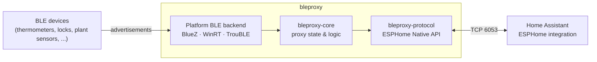

<div align="center">

# bleproxy

**An open-source Bluetooth Low Energy proxy for [Home Assistant], written in Rust.**

Extend Home Assistant's Bluetooth range with a Linux box, a Windows PC, or a
$5 ESP32, all speaking the [ESPHome Native API][esphome-api].

[](https://github.com/fiam/bleproxy/actions/workflows/ci.yml)
[](#license)
[](Cargo.toml)
[](https://github.com/fiam/bleproxy/pkgs/container/bleproxy)

</div>

> [!WARNING]
> **Early days.** This repository is the project's foundation: workspace,
> tooling, CI and release automation, plus the first shared types. It does
> **not** proxy Bluetooth traffic yet. See the [roadmap](#roadmap).

## Why

Home Assistant already supports [Bluetooth proxies][ha-bluetooth]. These are
devices near your sensors that listen for BLE advertisements and forward them
over the network. Today that mostly means flashing ESPHome onto an ESP32.

bleproxy aims to be a small, dependable alternative that:

- **runs where you already have hardware.** A Raspberry Pi, a NAS, a desktop
  or a microcontroller can all act as a proxy.
- **speaks the protocol Home Assistant already understands**, so it shows up
  like any ESPHome Bluetooth proxy, with no custom integration.
- **shares one Rust core across every target**, so behavior and bug fixes stay
  consistent from Linux to bare metal.

## How it fits



## Platform support

| Target | Binary | Status | BLE backend (planned) |
| --- | --- | --- | --- |
| Linux (x86_64, aarch64) | `bleproxy` | 🏗️ scaffold | BlueZ over D-Bus |
| Windows (x86_64) | `bleproxy` | 🏗️ scaffold | WinRT |
| macOS (Apple silicon) | `bleproxy` | 🏗️ scaffold, development host | CoreBluetooth |
| ESP32-C3 (RISC-V) | `bleproxy-esp32` | 🏗️ boots, prints banner | [TrouBLE] + esp-radio |
| ESP32-S3 (Xtensa) | `bleproxy-esp32` | 🏗️ boots, prints banner | [TrouBLE] + esp-radio |

Every target is built in CI on every change. Linux and Windows test suites
also run locally in containers (see [Cross-platform testing](#cross-platform-testing)).

## Getting started

### Prebuilt binaries

Each [release] ships archives for Linux (x86_64, aarch64), Windows (x86_64)
and macOS (Apple silicon), with SHA-256 checksums and
[build provenance attestations][attestations]:

```sh
gh attestation verify bleproxy-v0.1.0-x86_64-unknown-linux-gnu.tar.gz --repo fiam/bleproxy
```

### Container

Multi-arch images (`linux/amd64`, `linux/arm64`) are published to the GitHub
Container Registry. The image is distroless and runs as a non-root user:

```sh
docker run --rm ghcr.io/fiam/bleproxy:latest --version
```

When the BlueZ backend lands, the container will need the host's D-Bus socket
and host networking, so Home Assistant can discover it:

```sh
docker run -d --name bleproxy --network host \
  -v /run/dbus:/run/dbus:ro \
  ghcr.io/fiam/bleproxy:latest
```

### From source

```sh
git clone https://github.com/fiam/bleproxy && cd bleproxy
cargo run -p bleproxy -- --version
```

[rustup] installs the pinned toolchain from `rust-toolchain.toml`
automatically.

## Architecture

```text
bleproxy/
├── crates/
│   ├── bleproxy-core/       # no_std: BLE domain types and proxy logic
│   └── bleproxy-protocol/   # no_std: ESPHome Native API framing and messages
├── apps/
│   ├── bleproxy/            # host binary (Linux, Windows, macOS)
│   └── bleproxy-esp32/      # firmware (ESP32-C3, ESP32-S3)
├── xtask/                   # development task runner: `cargo xtask`
└── docker/                  # containers for cross-platform test runs
```

The split follows one rule: **shared crates never touch hardware or
sockets.**

- **`bleproxy-core`** owns the platform-neutral model (addresses,
  advertisements, and eventually proxy state). It is `#![no_std]`, forbids
  `unsafe`, and keeps advertisements in fixed-size buffers so the scan hot path
  never allocates.
- **`bleproxy-protocol`** owns the wire format. It is also `#![no_std]`. Its
  frame codec reads and writes caller-provided buffers, so the same code serves
  a Tokio socket and an Embassy TCP stack.
- **`apps/*`** are thin shells. They pick a runtime (Tokio on hosts, Embassy on
  microcontrollers), adapt the native BLE stack to core types, and wire
  everything together. Platform code goes behind traits defined by the shared
  crates, not behind `#[cfg]` in them.

The firmware is a workspace member, but it is excluded from `default-members`.
Plain `cargo build`/`test`/`clippy` therefore stay host-only and never need an
embedded toolchain.

## Development

### Prerequisites

| Tool | Needed for | Install |
| --- | --- | --- |
| [rustup] | everything | <https://rustup.rs> |
| [cargo-nextest] | faster tests (optional; falls back to `cargo test`) | `cargo install --locked cargo-nextest` |
| [cargo-deny] | supply-chain checks | `cargo install --locked cargo-deny` |
| [cargo-machete] | unused dependency checks | `cargo install --locked cargo-machete` |
| [cargo-llvm-cov] | coverage reports | `cargo install --locked cargo-llvm-cov` |
| Docker with buildx | cross-platform tests, container image | [Docker], [Colima] or similar |
| [espup] | ESP32-S3 firmware only | `cargo install --locked espup && espup install` |

Only rustup is required. Every other tool is optional, and the tasks that
need one tell you how to install it.

### Tasks

All development tasks go through [`cargo xtask`](xtask/src/main.rs), a small
Rust program, so they work identically on Linux, macOS and Windows, with no
`make` and no shell scripts. CI runs the very same commands.

| Command | What it does |
| --- | --- |
| `cargo xtask build` | Build the host workspace |
| `cargo xtask check` | Type-check the host workspace |
| `cargo xtask fmt` / `fmt-check` | Format code / verify formatting |
| `cargo xtask lint` | Clippy with all warnings denied |
| `cargo xtask test` | Tests via nextest (plus doctests) |
| `cargo xtask docs` | Build docs with warnings denied |
| `cargo xtask metadata` | Validate manifests and that `Cargo.lock` is current |
| `cargo xtask msrv` | Check the workspace with the minimum supported Rust (1.95) |
| `cargo xtask deny` | Advisories, licenses, bans and sources ([cargo-deny]) |
| `cargo xtask deps` | Find unused dependencies ([cargo-machete]) |
| `cargo xtask coverage` | Write an lcov report to `lcov.info` |
| `cargo xtask docker <platform>` | Run the test suite in a container |
| `cargo xtask esp32 [chip]` | Lint and build the firmware |
| `cargo xtask ci` | Everything CI runs on the host |

### Cross-platform testing

`cargo xtask docker <platform>` builds a test image and runs the full test
suite in it:

| Platform | How |
| --- | --- |
| `linux-arm64` | Official Rust image, native on Apple silicon and ARM hosts |
| `linux-amd64` | Same image under QEMU emulation |
| `windows` | Cross-compiled with MinGW, tests run under Wine |

The source tree is mounted read-only. Build artifacts are cached in Docker
volumes, so repeat runs are incremental.

### Firmware

```sh
cargo xtask esp32            # ESP32-C3, stable Rust
cargo xtask esp32 esp32s3    # ESP32-S3, needs espup (below)
```

The **ESP32-C3** is RISC-V and builds with the regular toolchain. The
**ESP32-S3** is Xtensa, which upstream LLVM doesn't support yet, so it needs
the esp-rs fork of the toolchain:

```sh
cargo install --locked espup
espup install
. ~/export-esp.sh            # each new shell; ~/export-esp.ps1 on Windows
```

To flash a board and open its serial console, install [espflash] and use the
runner configured in `.cargo/config.toml`:

```sh
cargo run -p bleproxy-esp32 --release --target riscv32imc-unknown-none-elf --features esp32c3
```

The firmware uses the current [esp-hal] 1.x stack with [esp-rtos] for
[Embassy] async tasks. BLE will come from `esp-radio` (whose
esp-hal-1.2-compatible release is currently `1.0.0-beta`) with [TrouBLE] as
the host stack. Both will be added together with the code that uses them.

## Quality and supply chain

- **Lints.** Clippy's `pedantic` and `nursery` groups, `missing_docs`,
  `unreachable_pub` and `rust_2018_idioms` apply to every crate through
  `[workspace.lints]`. `unwrap`/`expect`/`panic` are flagged outside tests,
  and `unsafe` is denied workspace-wide and forbidden in the shared crates.
  The few exceptions are documented next to the configuration.
- **Dependencies.** [`deny.toml`](deny.toml) enforces RustSec advisories
  (including unmaintained crates), an explicit license allowlist, a ban on
  duplicate versions in the host graph, and crates.io as the only source.
  cargo-audit isn't used, because it checks the same RustSec database.
- **CI.** Third-party GitHub Actions are pinned to commit SHAs and kept current
  by Dependabot. Workflow tokens are least-privilege.
- **Releases.** Binaries and container images carry signed
  [build provenance][attestations]. Images also include an SBOM.

## Releases

Releases are fully automated with [release-please]:

1. Every change lands on `main` as a [Conventional Commit][conventional]
   (pull requests are squash-merged, and their titles are checked).
2. release-please keeps a release PR open that bumps the version and updates
   `CHANGELOG.md`. `feat` bumps the minor version and `fix` the patch version.
   Breaking changes bump the minor version until 1.0.
3. Merging that PR tags `vX.Y.Z`, creates the GitHub Release, uploads binaries
   for every platform and publishes the multi-arch container image.

> [!NOTE]
> **One-time repository setup:**
> - Enable *Settings → Actions → General → Allow GitHub Actions to create and
>   approve pull requests*, so release-please can open its PR.
> - Optionally, add a `RELEASE_PLEASE_TOKEN` secret (a GitHub App token or a
>   fine-grained PAT) so CI also runs on the release PR.
> - Allow only squash merging.

## Roadmap

- [x] Workspace, lint policy, CI, supply-chain checks
- [x] Release automation: binaries, multi-arch images, provenance
- [x] Core BLE types and ESPHome plaintext frame codec
- [x] Firmware boots on ESP32-C3 and ESP32-S3
- [ ] Passive BLE scanning on Linux (BlueZ)
- [ ] ESPHome Native API server: hello, device info, raw advertisement forwarding
- [ ] mDNS advertisement so Home Assistant discovers the proxy
- [ ] Noise encryption (ESPHome API encryption keys)
- [ ] Windows backend
- [ ] BLE scanning on ESP32 via esp-radio and TrouBLE
- [ ] Active connections (GATT proxying)

## Acknowledgements

bleproxy draws inspiration from [yuzi-co/btproxy] and [ankon/btproxy], and
builds on the excellent [esp-rs] and [Embassy] ecosystems, including [TrouBLE].

## Contributing

Contributions are welcome! See [CONTRIBUTING.md](CONTRIBUTING.md) for the
workflow and conventions. If you are a coding agent, also read
[AGENTS.md](AGENTS.md).

## License

Licensed under either of

- Apache License, Version 2.0 ([LICENSE-APACHE](LICENSE-APACHE) or
  <https://www.apache.org/licenses/LICENSE-2.0>)
- MIT license ([LICENSE-MIT](LICENSE-MIT) or <https://opensource.org/licenses/MIT>)

at your option.

Unless you explicitly state otherwise, any contribution intentionally submitted
for inclusion in the work by you, as defined in the Apache-2.0 license, shall
be dual licensed as above, without any additional terms or conditions.

[Home Assistant]: https://www.home-assistant.io
[esphome-api]: https://esphome.io/components/api.html
[ha-bluetooth]: https://www.home-assistant.io/integrations/bluetooth/
[release]: https://github.com/fiam/bleproxy/releases
[attestations]: https://docs.github.com/en/actions/security-for-github-actions/using-artifact-attestations
[rustup]: https://rustup.rs
[cargo-nextest]: https://nexte.st
[cargo-deny]: https://github.com/EmbarkStudios/cargo-deny
[cargo-machete]: https://github.com/bnjbvr/cargo-machete
[cargo-llvm-cov]: https://github.com/taiki-e/cargo-llvm-cov
[Docker]: https://docs.docker.com/get-docker/
[Colima]: https://github.com/abiosoft/colima
[espup]: https://github.com/esp-rs/espup
[espflash]: https://github.com/esp-rs/espflash
[esp-hal]: https://github.com/esp-rs/esp-hal
[esp-rtos]: https://github.com/esp-rs/esp-hal/tree/main/esp-rtos
[esp-rs]: https://github.com/esp-rs
[Embassy]: https://embassy.dev
[TrouBLE]: https://github.com/embassy-rs/trouble
[release-please]: https://github.com/googleapis/release-please
[conventional]: https://www.conventionalcommits.org
[yuzi-co/btproxy]: https://github.com/yuzi-co/btproxy
[ankon/btproxy]: https://github.com/ankon/btproxy
