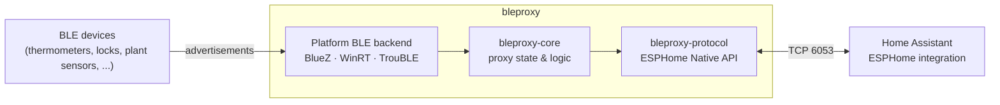

<div align="center">

# bleproxy

**An open-source Bluetooth Low Energy proxy for [Home Assistant], written in Rust.**

Extend Home Assistant's Bluetooth range with a Linux box, a Windows PC, or a
$5 ESP32, all speaking the [ESPHome Native API][esphome-api].

[](https://github.com/fiam/bleproxy/actions/workflows/ci.yml)
[](#license)
[](Cargo.toml)
[](https://github.com/fiam/bleproxy/pkgs/container/bleproxy)

</div>

> [!NOTE]
> **Early, but working on Linux.** On a Linux host with BlueZ, bleproxy
> already acts as a passive Bluetooth proxy for Home Assistant: it is
> discovered automatically and forwards advertisements. Active connections
> (GATT), encryption and Bluetooth scanning on Windows, macOS and ESP32 are
> still to come. See the [roadmap](#roadmap).

## Why

Home Assistant already supports [Bluetooth proxies][ha-bluetooth]. These are
devices near your sensors that listen for BLE advertisements and forward them
over the network. Today that mostly means flashing ESPHome onto an ESP32.

bleproxy aims to be a small, dependable alternative that:

- **runs where you already have hardware.** A Raspberry Pi, a NAS, a desktop
  or a microcontroller can all act as a proxy.
- **speaks the protocol Home Assistant already understands**, so it shows up
  like any ESPHome Bluetooth proxy, with no custom integration.
- **shares one Rust core across every target**, so behavior and bug fixes stay
  consistent from Linux to bare metal.

## How it fits



## Platform support

| Target | Binary | Status | BLE backend |
| --- | --- | --- | --- |
| Linux (x86_64, aarch64) | `bleproxy` | ✅ passive proxy | BlueZ over D-Bus (active or passive scanning) |
| Windows (x86_64) | `bleproxy` | 🏗️ API only, no scanning yet | WinRT (planned) |
| macOS (Apple silicon) | `bleproxy` | 🏗️ API only, no scanning yet | CoreBluetooth (planned) |
| ESP32-C3 (RISC-V) | `bleproxy-esp32` | 🏗️ boots, prints banner | [TrouBLE] + esp-radio (planned) |
| ESP32-S3 (Xtensa) | `bleproxy-esp32` | 🏗️ boots, prints banner | [TrouBLE] + esp-radio (planned) |

Every target is built in CI on every change. Linux and Windows test suites
also run locally in containers (see [Cross-platform testing](#cross-platform-testing)).

## Running it on a Linux server

You need a Linux host with a Bluetooth adapter, BlueZ (`bluetoothd`) running
and the host on the same network as Home Assistant. Check the adapter with
`bluetoothctl show`.

### With Docker

```sh
docker run -d --name bleproxy --restart unless-stopped \
  --network host \
  -v /run/dbus:/run/dbus:ro \
  ghcr.io/fiam/bleproxy:edge
```

or `docker compose -f deploy/compose.yaml up -d` with
[`deploy/compose.yaml`](deploy/compose.yaml). Host networking lets Home
Assistant discover the proxy over mDNS. The read-only `/run/dbus` mount gives
access to BlueZ. The image runs unprivileged, as `nobody`.

Images are published for `linux/amd64` and `linux/arm64`: `:edge` follows
`main`, `:latest` and `:X.Y.Z` are releases.

### As a systemd service

Download a binary from the [releases][release] or build one
(`cargo install --locked --git https://github.com/fiam/bleproxy bleproxy`),
then install it with the unit and the user it runs as:

```sh
sudo install -m 0755 bleproxy /usr/local/bin/bleproxy
sudo install -D -m 0644 deploy/bleproxy.sysusers /etc/sysusers.d/bleproxy.conf
sudo systemd-sysusers
sudo install -m 0644 deploy/bleproxy.service /etc/systemd/system/
sudo systemctl daemon-reload && sudo systemctl enable --now bleproxy
journalctl -u bleproxy -f
```

The [unit](deploy/bleproxy.service) runs as an unprivileged user in a tight
sandbox (`systemd-analyze security` rates it 1.5).

### Adding it to Home Assistant

Home Assistant discovers the proxy through the ESPHome integration: accept
the notification under **Settings → Devices & services**. If mDNS doesn't
reach Home Assistant, add an **ESPHome** device by hand with the server's
address and port 6053, and leave the encryption key empty.

Once added, the proxy shows up under **Settings → Bluetooth** as a remote
scanner, and Bluetooth devices near the server appear in Home Assistant.

### Configuration

Every option is a command-line flag and a `BLEPROXY_*` environment variable:

| Flag | Environment | Default | Meaning |
| --- | --- | --- | --- |
| `--name` | `BLEPROXY_NAME` | `bleproxy-<mac suffix>` | Device and mDNS host name (lowercase letters, digits, hyphens) |
| `--friendly-name` | `BLEPROXY_FRIENDLY_NAME` | `bleproxy <MAC SUFFIX>` | Name shown in Home Assistant |
| `--adapter` | `BLEPROXY_ADAPTER` | `hci0` | Bluetooth adapter to scan with |
| `--scan-mode` | `BLEPROXY_SCAN_MODE` | `active` | `active` or `passive` (see below) |
| `--mac` | `BLEPROXY_MAC` | the adapter's address | Address identifying the proxy in Home Assistant |
| `--listen` | `BLEPROXY_LISTEN` | `0.0.0.0:6053` | Address and port of the ESPHome API |
| `--no-mdns` | `BLEPROXY_NO_MDNS` | off | Don't announce the proxy over mDNS |
| `--log-level` | `BLEPROXY_LOG` | `info` | `error`, `warn`, `info`, `debug` or `trace` |

**Scan modes.** `active` (BlueZ discovery) sends scan requests, so it sees
every device along with its scan response data. `passive` only listens,
through a BlueZ advertisement monitor, which spares battery-powered devices
the extra radio traffic. Like Home Assistant's own passive scanning, it
matches advertisements by their flags, so devices that advertise without
flags are not seen, and it needs a BlueZ with the advertisement monitor API
(older releases only enable it with `bluetoothd --experimental`).

### Troubleshooting

- **No advertisements:** run with `BLEPROXY_LOG=debug`, check
  `bluetoothctl show` (powered, not blocked by `rfkill`), and in passive mode
  look for errors registering the monitor; try `--scan-mode active`.
- **Cannot use Bluetooth adapter:** BlueZ isn't reachable. Check that
  `bluetoothd` runs and, in Docker, that `/run/dbus` is mounted.
- **Not discovered:** mDNS must reach Home Assistant (same network or VLAN
  reflector, port 5353/udp open), or add the device by hand.

### Prebuilt binaries

Each [release] ships archives for Linux (x86_64, aarch64), Windows (x86_64)
and macOS (Apple silicon), with SHA-256 checksums and
[build provenance attestations][attestations]:

```sh
gh attestation verify bleproxy-v0.1.0-x86_64-unknown-linux-gnu.tar.gz --repo fiam/bleproxy
```

### From source

```sh
git clone https://github.com/fiam/bleproxy && cd bleproxy
cargo run -p bleproxy -- --help
```

[rustup] installs the pinned toolchain from `rust-toolchain.toml`
automatically. On macOS and Windows the binary serves the API without
scanning, which is handy for development.

## Architecture

```text
bleproxy/
├── crates/
│   ├── bleproxy-core/       # no_std: BLE types, advertising data, API session logic
│   └── bleproxy-protocol/   # no_std: ESPHome Native API framing and messages
├── apps/
│   ├── bleproxy/            # host app (Linux, Windows, macOS)
│   │   └── src/             # server, mdns, bluez (Linux), identity, main
│   └── bleproxy-esp32/      # firmware (ESP32-C3, ESP32-S3)
├── deploy/                  # systemd unit, sysusers config, Compose file
├── docker/                  # containers for cross-platform and end-to-end tests
└── xtask/                   # development task runner: `cargo xtask`
```

The split follows one rule: **shared crates never touch hardware or
sockets.**

- **`bleproxy-protocol`** owns the wire format: plaintext frames and the
  protobuf messages a passive Bluetooth proxy exchanges, encoded and decoded
  without allocating into caller-provided buffers. It is `#![no_std]`, so the
  same code can serve a Tokio socket and an Embassy TCP stack.
- **`bleproxy-core`** owns the proxy's behavior: device addresses, UUIDs and
  advertisements (in fixed-size buffers, so the scan path never allocates),
  rebuilding advertising data from parsed fields, and the API `Session`, a
  sans-I/O state machine that turns client messages into replies. It is
  `#![no_std]` and forbids `unsafe`.
- **`apps/bleproxy`** is the I/O around them, on Tokio:
  - `server` accepts API connections, drives a `Session` per client and
    forwards batched advertisements to subscribers.
  - `mdns` announces the proxy like an ESPHome device.
  - `bluez` (Linux) follows BlueZ over D-Bus and publishes advertisements on
    a broadcast channel.

  It is a library plus a thin binary, so integration tests drive the server
  directly.
- **`apps/bleproxy-esp32`** boots the chip with Embassy; its BLE and network
  stacks will feed the same core types.

The firmware is a workspace member, but it is excluded from `default-members`.
Plain `cargo build`/`test`/`clippy` therefore stay host-only and never need an
embedded toolchain.

## Development

### Prerequisites

| Tool | Needed for | Install |
| --- | --- | --- |
| [rustup] | everything | <https://rustup.rs> |
| [cargo-nextest] | faster tests (optional; falls back to `cargo test`) | `cargo install --locked cargo-nextest` |
| [cargo-deny] | supply-chain checks | `cargo install --locked cargo-deny` |
| [cargo-machete] | unused dependency checks | `cargo install --locked cargo-machete` |
| [cargo-llvm-cov] | coverage reports | `cargo install --locked cargo-llvm-cov` |
| Docker with buildx | cross-platform tests, container image | [Docker], [Colima] or similar |
| [espup] | ESP32-S3 firmware only | `cargo install --locked espup && espup install` |

Only rustup is required. Every other tool is optional, and the tasks that
need one tell you how to install it.

### Tasks

All development tasks go through [`cargo xtask`](xtask/src/main.rs), a small
Rust program, so they work identically on Linux, macOS and Windows, with no
`make` and no shell scripts. CI runs the very same commands.

| Command | What it does |
| --- | --- |
| `cargo xtask build` | Build the host workspace |
| `cargo xtask check` | Type-check the host workspace |
| `cargo xtask fmt` / `fmt-check` | Format code / verify formatting |
| `cargo xtask lint` | Clippy with all warnings denied |
| `cargo xtask test` | Tests via nextest (plus doctests) |
| `cargo xtask docs` | Build docs with warnings denied |
| `cargo xtask metadata` | Validate manifests and that `Cargo.lock` is current |
| `cargo xtask msrv` | Check the workspace with the minimum supported Rust (1.95) |
| `cargo xtask deny` | Advisories, licenses, bans and sources ([cargo-deny]) |
| `cargo xtask deps` | Find unused dependencies ([cargo-machete]) |
| `cargo xtask coverage` | Write an lcov report to `lcov.info` |
| `cargo xtask docker <platform>` | Run the test suite in a container |
| `cargo xtask e2e` | End-to-end test: mock BlueZ, bleproxy and Home Assistant's client |
| `cargo xtask esp32 [chip]` | Lint and build the firmware |
| `cargo xtask ci` | Everything CI runs on the host |

### Cross-platform testing

`cargo xtask docker <platform>` builds a test image and runs the full test
suite in it:

| Platform | How |
| --- | --- |
| `linux-arm64` | Official Rust image, native on Apple silicon and ARM hosts |
| `linux-amd64` | Same image under QEMU emulation |
| `windows` | Cross-compiled with MinGW, tests run under Wine |

The source tree is mounted read-only. Build artifacts are cached in Docker
volumes, so repeat runs are incremental.

### End-to-end test

`cargo xtask e2e` exercises the whole Linux path without Bluetooth hardware,
in both scan modes:

- A container runs a real system bus with BlueZ's access rules and a mock
  BlueZ (python-dbusmock).
- bleproxy runs against it as an unprivileged user.
- aioesphomeapi, the client library Home Assistant uses, checks the device
  info and that new and updated devices arrive as the expected raw
  advertisements.

### Firmware

```sh
cargo xtask esp32            # ESP32-C3, stable Rust
cargo xtask esp32 esp32s3    # ESP32-S3, needs espup (below)
```

The **ESP32-C3** is RISC-V and builds with the regular toolchain. The
**ESP32-S3** is Xtensa, which upstream LLVM doesn't support yet, so it needs
the esp-rs fork of the toolchain:

```sh
cargo install --locked espup
espup install
. ~/export-esp.sh            # each new shell; ~/export-esp.ps1 on Windows
```

To flash a board and open its serial console, install [espflash] and use the
runner configured in `.cargo/config.toml`:

```sh
cargo run -p bleproxy-esp32 --release --target riscv32imc-unknown-none-elf --features esp32c3
```

The firmware uses the current [esp-hal] 1.x stack with [esp-rtos] for
[Embassy] async tasks. BLE will come from `esp-radio` (whose
esp-hal-1.2-compatible release is currently `1.0.0-beta`) with [TrouBLE] as
the host stack. Both will be added together with the code that uses them.

## Quality and supply chain

- **Lints.** Clippy's `pedantic` and `nursery` groups, `missing_docs`,
  `unreachable_pub` and `rust_2018_idioms` apply to every crate through
  `[workspace.lints]`. `unwrap`/`expect`/`panic` are flagged outside tests,
  and `unsafe` is denied workspace-wide and forbidden in the shared crates.
  The few exceptions are documented next to the configuration.
- **Dependencies.** [`deny.toml`](deny.toml) enforces RustSec advisories
  (including unmaintained crates), an explicit license allowlist, a ban on
  duplicate versions in the host graph, and crates.io as the only source.
  cargo-audit isn't used, because it checks the same RustSec database.
- **CI.** Third-party GitHub Actions are pinned to commit SHAs and kept current
  by Dependabot. Workflow tokens are least-privilege.
- **Releases.** Binaries and container images carry signed
  [build provenance][attestations]. Images also include an SBOM.

## Releases

Releases are fully automated with [release-please]:

1. Every change lands on `main` as a [Conventional Commit][conventional]
   (pull requests are squash-merged, and their titles are checked).
2. release-please keeps a release PR open that bumps the version and updates
   `CHANGELOG.md`. `feat` bumps the minor version and `fix` the patch version.
   Breaking changes bump the minor version until 1.0.
3. Merging that PR tags `vX.Y.Z`, creates the GitHub Release, uploads binaries
   for every platform and publishes the multi-arch container image.

> [!NOTE]
> **One-time repository setup:**
> - Enable *Settings → Actions → General → Allow GitHub Actions to create and
>   approve pull requests*, so release-please can open its PR.
> - Optionally, add a `RELEASE_PLEASE_TOKEN` secret (a GitHub App token or a
>   fine-grained PAT) so CI also runs on the release PR.
> - Allow only squash merging.

## Roadmap

- [x] Workspace, lint policy, CI, supply-chain checks
- [x] Release automation: binaries, multi-arch images, provenance
- [x] ESPHome Native API server: hello, device info, raw advertisement forwarding
- [x] mDNS announcement so Home Assistant discovers the proxy
- [x] BLE scanning on Linux through BlueZ, active or passive
- [x] Firmware boots on ESP32-C3 and ESP32-S3
- [ ] Scanner state and mode switching from Home Assistant
- [ ] Noise encryption (ESPHome API encryption keys)
- [ ] Active connections (GATT proxying)
- [ ] Windows and macOS backends
- [ ] BLE scanning on ESP32 via esp-radio and TrouBLE

## Acknowledgements

bleproxy draws inspiration from [yuzi-co/btproxy] and [ankon/btproxy], and
builds on the excellent [esp-rs] and [Embassy] ecosystems, including [TrouBLE].

## Contributing

Contributions are welcome! See [CONTRIBUTING.md](CONTRIBUTING.md) for the
workflow and conventions. If you are a coding agent, also read
[AGENTS.md](AGENTS.md).

## License

Licensed under either of

- Apache License, Version 2.0 ([LICENSE-APACHE](LICENSE-APACHE) or
  <https://www.apache.org/licenses/LICENSE-2.0>)
- MIT license ([LICENSE-MIT](LICENSE-MIT) or <https://opensource.org/licenses/MIT>)

at your option.

Unless you explicitly state otherwise, any contribution intentionally submitted
for inclusion in the work by you, as defined in the Apache-2.0 license, shall
be dual licensed as above, without any additional terms or conditions.

[Home Assistant]: https://www.home-assistant.io
[esphome-api]: https://esphome.io/components/api.html
[ha-bluetooth]: https://www.home-assistant.io/integrations/bluetooth/
[release]: https://github.com/fiam/bleproxy/releases
[attestations]: https://docs.github.com/en/actions/security-for-github-actions/using-artifact-attestations
[rustup]: https://rustup.rs
[cargo-nextest]: https://nexte.st
[cargo-deny]: https://github.com/EmbarkStudios/cargo-deny
[cargo-machete]: https://github.com/bnjbvr/cargo-machete
[cargo-llvm-cov]: https://github.com/taiki-e/cargo-llvm-cov
[Docker]: https://docs.docker.com/get-docker/
[Colima]: https://github.com/abiosoft/colima
[espup]: https://github.com/esp-rs/espup
[espflash]: https://github.com/esp-rs/espflash
[esp-hal]: https://github.com/esp-rs/esp-hal
[esp-rtos]: https://github.com/esp-rs/esp-hal/tree/main/esp-rtos
[esp-rs]: https://github.com/esp-rs
[Embassy]: https://embassy.dev
[TrouBLE]: https://github.com/embassy-rs/trouble
[release-please]: https://github.com/googleapis/release-please
[conventional]: https://www.conventionalcommits.org
[yuzi-co/btproxy]: https://github.com/yuzi-co/btproxy
[ankon/btproxy]: https://github.com/ankon/btproxy
